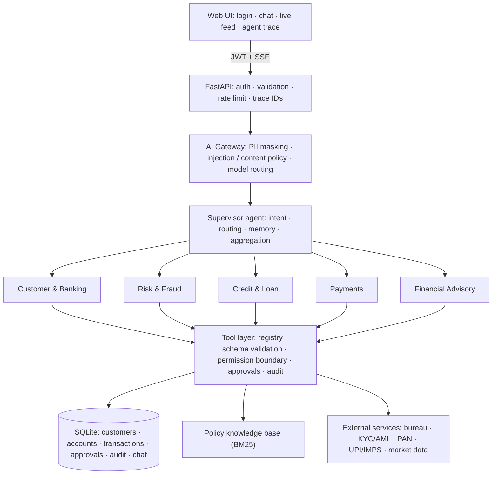

# Wrench Wise Task
<div align="center">

# 🏦 BankMind

### Multi-Agent AI Banking Assistant — Simulated Real-Time Banking Architecture

A Supervisor agent understands natural-language requests, routes them to specialist agents, and those agents act through governed banking tools and external services — with streaming answers, human-in-the-loop approvals and full audit trails.

## [🎥 Demo Video](https://drive.google.com/file/d/1HBvKdBPpjAdivaXwPjAp3sB17rQgTm9W/view?usp=drivesdk)


`Python` · `FastAPI` · `SQLite` · `Claude / OpenAI-compatible LLMs` · `Server-Sent Events` · `JWT` · `pytest`

</div>

---

## 📌 Overview
Built for the **Wrench Wise AI/ML Internship technical assignment**: *"Build an application for simulated real-time banking architecture with multi-agent automation."*
The project implements a working MVP of the provided reference architecture: a Supervisor/Orchestrator, five specialised agents, simulated banking APIs, external services, an AI-gateway of guardrails, and a web interface.

## ✅ Assignment Requirements Coverage
| Requirement | Implementation |
|---|---|
| Supervisor / Orchestrator agent that routes requests | LLM intent routing (small fast model) with rule-based backup — `backend/app/agents.py` |
| At least 3 specialised agents | **5 agents:** Customer & Banking · Risk & Fraud · Credit & Loan · Payments · Financial Advisory |
| Simulated banking APIs / tools | ~15 governed tools over a SQLite core-banking store — `tools.py`, `db.py` |
| Natural-language interaction using an LLM | Streaming tool-use loop with Claude or any OpenAI-compatible model — `llm.py` |
| 3–5 working banking use cases | 5 use cases (below) |
| Simple, user-friendly interface | Login, chat, customer overview, live transaction feed, agent trace — `frontend/index.html` |

## ✨ Features
- **Multi-agent orchestration** — Supervisor selects 1–2 agents per request; each agent can only call its own tools (permission boundary).
- **Streaming responses** — answers appear word-by-word (SSE); the agent trace updates live.
- **Authentication** — username/password (scrypt-hashed), signed JWT sessions, account lockout after 5 failed logins.
- **Persistent storage** — SQLite for customers, accounts, cards, loans, transactions, approvals, audit log and chat history.
- **External services layer (simulated)** — credit bureau, KYC/AML screening, government PAN API, UPI/IMPS payment network, market data — behind retry + circuit-breaker, every call logged.
- **Safety & governance** — PII masking, prompt-injection and off-topic blocking, schema validation, session-bound authorization, human approval + password step-up for large transfers, AML fail-closed.
- **Observability** — per-request trace IDs, tool-call audit log, metrics, external-service health panel.
- **RAG-lite** — BM25 retrieval over bank policy documents so the Credit agent cites policy IDs.
- **Resilience** — graceful fallbacks when the LLM, bureau or payment network is unavailable (payments never debit without network success).

## 🎯 Use Cases
1. **Account & spending insights** — *"What is my account summary?"*, *"Show my spending by category"*
2. **Fraud detection & card blocking** — *"Any suspicious transactions?"* → *"Block my card"*
3. **Loan eligibility & KYC** — live bureau score, FOIR check, policy-grounded reasons / counter-offers; *"Complete my KYC"*
4. **Transfers with approval** — *"Send 5000 to Ravi"* (instant) vs *"Transfer 40000 to Meera"* (approval card + password)
5. **Market rates & saving advice** — *"What is the USD to INR rate?"*, *"How can I save more?"*

## 🧱 Architecture

Full diagram, request flow, mapping to the reference architecture and design decisions: **[docs/ARCHITECTURE.md](docs/ARCHITECTURE.md)**.

## 🛠 Tech Stack
| Layer | Technology |
|---|---|
| Backend | Python 3.10+, FastAPI, Uvicorn, Pydantic |
| AI | Anthropic Claude **or** any OpenAI-compatible model (OpenAI, Groq, local Ollama) with tool calling + streaming |
| Data | SQLite (WAL) |
| Security | scrypt password hashing, PyJWT (HS256), rate limiting, guardrails |
| Frontend | Vanilla HTML/CSS/JS, Server-Sent Events |
| Testing / Deploy | pytest (27 tests), Docker, Render blueprint |

## 🚀 Getting Started
### Quick start
```bash
git clone https://github.com/YOUR-USERNAME/bankmind.git
cd bankmind
./run.sh            # macOS / Linux      (Windows: run.bat)
```
Open **http://localhost:8000**.

### Manual setup
```bash
python -m venv .venv && source .venv/bin/activate     # Windows: .venv\Scripts\activate
pip install -r requirements.txt
cp .env.example .env                                  # then add your LLM settings
uvicorn backend.app.main:app --port 8000
```

### Connect an LLM
| Option | `.env` settings |
|---|---|
| Anthropic Claude | `ANTHROPIC_API_KEY=...` (optional `LLM_MODEL`, `LLM_ROUTER_MODEL`) |
| OpenAI / Groq / Together | `LLM_PROVIDER=openai`, `OPENAI_API_KEY=...`, `OPENAI_BASE_URL=...`, `LLM_MODEL=...` |
| Free local (Ollama) | `LLM_PROVIDER=openai`, `OPENAI_BASE_URL=http://localhost:11434/v1`, `LLM_MODEL=llama3.1` (needs tool-calling support) |

Without a model the app still runs using built-in fallback logic (fixed wording), so configure a model for AI-generated answers.

### Demo accounts
| Username | Password | Try this |
|---|---|---|
| `aarav.sharma` | `Aarav@2026` | Loan approved · transfers to Ravi / Meera · USD rate |
| `priya.nair` | `Priya@2026` | Suspicious transactions → block card · counter-offer loan · transfer to Anita |
| `rohan.mehta` | `Rohan@2026` | Loan declined (KYC pending) → *"complete my KYC"* → approved · "send 1000 to Blocked Entity" → AML rejection |

*All data is fictional.*

## 🧪 Testing
```bash
python -m pytest -q tests
```
27 tests cover authentication and lockout, all use cases, external-service failures and the circuit breaker, approvals (single-use, step-up), guardrails, streaming (SSE), the LLM tool-use loop with a fake provider, provider adapters, and observability.

## ☁️ Deployment
One-click **Render** blueprint (`render.yaml`), `Dockerfile`, `Procfile`; Hugging Face Spaces and Railway also work. See **[docs/DEPLOY.md](docs/DEPLOY.md)**.

## 📁 Project Structure
```
bankmind/
├── backend/app/
│   ├── main.py          # API: auth, SSE streaming, approvals, live feed, metrics
│   ├── agents.py        # Supervisor + 5 specialist agents (streaming generator)
│   ├── tools.py         # Governed banking tools (registry, validation, permissions, audit)
│   ├── external.py      # External services layer + retry/circuit breaker
│   ├── llm.py           # Provider-agnostic LLM client with streaming
│   ├── guardrails.py    # PII masking, injection / content policy
│   ├── knowledge.py     # Policy documents + BM25 retrieval
│   ├── db.py            # SQLite schema, seed data, helpers
│   └── auth.py / security.py
├── frontend/index.html  # Web UI
├── tests/test_app.py
├── docs/                # ARCHITECTURE · DEPLOY · SUBMISSION_CHECKLIST · DEMO_SCRIPT
├── Dockerfile · Procfile · render.yaml · run.sh · run.bat
└── requirements.txt · .env.example
```

## 🔐 Design Decisions
- **The model reasons; code decides.** Loan eligibility, fraud scoring, limits and approvals are deterministic and tested; the LLM orchestrates and explains.
- **Security by construction.** The customer identity comes from the signed session, never from the model; each agent can call only its registered tools.
- **Human in the loop.** Transfers above ₹25,000 need explicit approval plus password re-entry; approvals are single-use.
- **Fail safe.** AML screening fails closed; payments never debit unless the payment network succeeds.

## ⚠️ Limitations & Future Work
Single-process SQLite (→ Postgres) · external providers are simulated (→ real HTTP clients) · BM25 only (→ embeddings + reranker) · no MFA / refresh tokens · more agents (Compliance, Notification) · LLM-as-judge evaluation of routing quality · token-budget enforcement.


## 👤 Author
**Sai Ganesh Depuru** — AI/ML Intern candidate, Wrench Wise
[GitHub](https://github.com/saiganesh2006) · [LinkedIn](https://www.linkedin.com/in/sai-ganesh-depuru-410560281/) · saiganeshdepuru24@gmail.com
