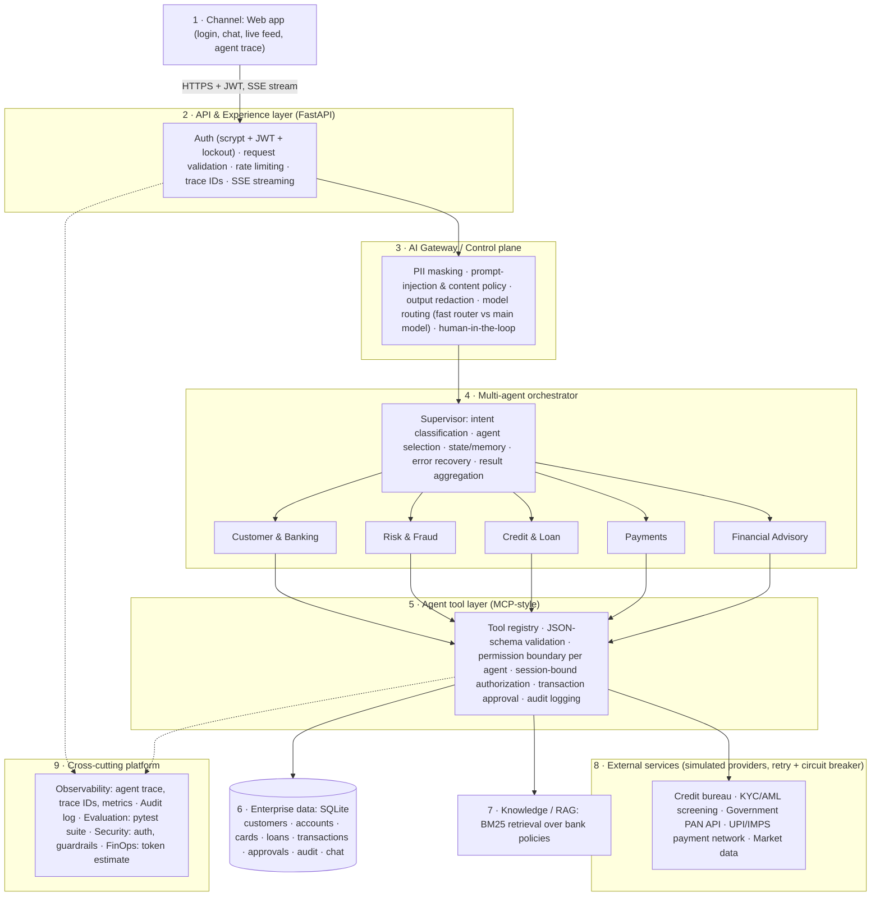

# Architecture & Approach

## 1. What was built
BankMind is a working MVP of a **simulated real-time banking platform** in which a **Supervisor agent** understands a
customer's natural-language request, routes it to **specialist agents**, and those agents act through **governed
banking tools and external services**. It follows the layered reference architecture provided with the assignment,
implementing the layers that make multi-agent behaviour real and safe, and keeping the rest intentionally simple.

## 2. System diagram

## 3. Request flow (what happens on "Transfer 40000 to Meera")
1. Browser sends the message with a JWT; the API checks the token, rate limit and validates input.
2. **Guardrails** mask PII and block prompt-injection / off-topic requests.
3. **Supervisor** classifies intent with a small fast model (rule-based backup if unavailable) → selects the *Payments* agent.
4. The agent runs a **streaming tool-use loop**; only tools registered to it are callable. `customer_id` is injected from the
   session, never from the model.
5. `initiate_transfer` validates the beneficiary, balance and daily limit, **AML-screens the payee** (external service, fails
   closed), and because the amount exceeds ₹25,000 returns `PENDING_APPROVAL` instead of moving money.
6. The UI shows an approval card. Approving requires the **password again**; money moves via the **payment network (UPI/IMPS)**
   and the debit is applied in one database transaction. Approvals are single-use.
7. Every tool and external call is written to the audit log with a **trace ID**; tokens stream to the browser as they are generated.

## 4. Mapping to the reference architecture
| Layer | Status | Where |
|---|---|---|
| 1 Channels | Web channel built; mobile/branch/call-centre are out of scope | `frontend/index.html` |
| 2 API & Experience | Auth, validation, rate limiting, trace IDs, SSE | `main.py`, `auth.py`, `security.py` |
| 3 AI Gateway | PII masking, injection/content policy, model routing, human-in-the-loop | `guardrails.py`, `llm.py`, `agents.py` |
| 4 Orchestrator | Supervisor + 5 agents (Customer/Banking, Risk/Fraud, Credit, Payments, Advisory) | `agents.py` |
| 5 Tool / MCP layer | Registry, schema validation, authorization, permission boundary, approvals, audit | `tools.py` |
| 6 Enterprise data | SQLite persistence | `db.py` |
| 7 Knowledge / RAG | BM25 over policy documents (embeddings + reranker = future work) | `knowledge.py` |
| 8 External services | Bureau, KYC/AML, PAN, payments, market data (simulated, with resilience) | `external.py` |
| 9 Cross-cutting | Observability (trace, metrics), audit, evaluation (tests), security, token estimate | `main.py /api/metrics`, `tests/` |

Not implemented (by design, per the brief): WAF, OAuth2/OIDC provider, Compliance/Research/Document/Notification agents,
vector DB, MCP network gateway, cost budgets.

## 5. Design decisions
1. **Supervisor + specialists, not one big prompt** – smaller prompts, least-privilege tools, easier to test.
2. **The model reasons; code decides.** Eligibility (KYC, bureau score, FOIR), fraud scoring, limits and approvals are deterministic
   and unit-tested. The model orchestrates and explains, so money decisions are auditable.
3. **Security by construction** – tokens identify the customer; tools can't be given another customer's id; agents can't call
   tools outside their boundary; step-up password for approvals; AML fails closed; passwords hashed; lockout.
4. **Resilience** – timeouts/retries/circuit breaker for external services; bureau outage falls back to the stored score; payment
   failure never debits; LLM failure falls back to built-in logic.
5. **Perceived speed** – token streaming, live trace, a small model for routing, no extra synthesis pass for multi-agent answers.
6. **Model-agnostic** – one neutral message format; Anthropic and any OpenAI-compatible model (incl. local) plug in via `.env`.

## 6. Limitations & next steps
Single-process SQLite (→ Postgres), simulated providers (→ real HTTP clients), BM25 only (→ embeddings + reranker), no MFA/refresh
tokens, no token-budget enforcement, LLM-as-judge evaluation of routing quality, more agents (Compliance, Notification).
